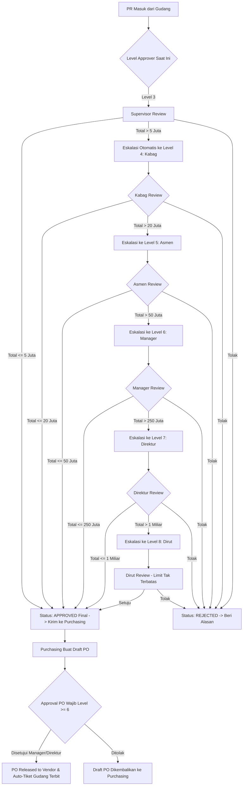

# Spesifikasi Desain UI/UX - Portal Level Approval & Otorisasi Berjenjang
**Sistem Permohonan Barang (Goods Request System)**

---

## 1. Ringkasan & Ruang Lingkup Sistem Approval

Portal Level Approval dirancang untuk memfasilitasi pengambilan keputusan pengadaan barang secara cepat, akuntabel, dan transparan bagi pimpinan organisasi berjenjang (Level 3 s/d Level 8) serta administrator sistem (`SYST000`).

Sistem ini menerapkan dua pilar aturan bisnis utama:
1. **Dynamic PR Threshold Routing**: Dokumen permohonan barang (PR) dievaluasi berdasarkan total estimasi nilai belanja (`total_estimated_amount` dari `qty_to_buy`). Jika nilai belanja melebihi batas wewenang approver saat ini, sistem mengeskalasikannya ke pimpinan level berikutnya secara otomatis.
2. **PO Approval Enforcement (Level $\ge$ 6)**: Dokumen Purchase Order (PO) yang diterbitkan Purchasing hanya dapat disetujui oleh level jabatan Manager (Level 6), Direktur (Level 7), atau Direktur Utama (Level 8).

---

## 2. Matriks Pengguna & Batasan Wewenang (RBAC)

| Level | Kode Role | Jabatan | Otoritas PR | Otoritas PO | Rentang Default Nominal (IDR) |
|:---:|:---|:---|:---:|:---:|:---|
| **3** | `SUPERVISOR` | Supervisor | Ya (L1) | ❌ Dilarang | Rp 0 s/d Rp 5.000.000 |
| **4** | `KEPALA_BAGIAN` | Kepala Bagian / Kabag | Ya (L2) | ❌ Dilarang | Rp 5.000.001 s/d Rp 20.000.000 |
| **5** | `ASISTEN_MANAGER`| Asisten Manager | Ya (L3) | ❌ Dilarang | Rp 20.000.001 s/d Rp 50.000.000 |
| **6** | `MANAGER` | Manager Departemen | Ya (L4) | ✅ **Minimal PO** | Rp 50.000.001 s/d Rp 250.000.000 |
| **7** | `DIREKTUR` | Direktur Operasional/Keuangan | Ya (L5) | ✅ Berhak | Rp 250.000.001 s/d Rp 1.000.000.000 |
| **8** | `DIREKTUR_UTAMA`| Direktur Utama (CEO) | Ya (Final L6)| ✅ Berhak | > Rp 1.000.000.000 (Tanpa Batas Atas) |
| **0** | `SYST000` | Superadmin Sistem | Master Config | Master Config | Mengatur besaran threshold & delegasi |

---

## 3. Arsitektur Alur Persetujuan (Workflow Diagram)

---

## 4. Struktur Antarmuka Pengguna (UI Modules)

Antarmuka dirancang dengan tata letak adaptif dan berfokus pada kecepatan respon (Zero Friction Approval):

### A. Role Switcher & Wewenang Aktif (Context Header)
* Menampilkan profil pejabat yang sedang login, level hierarki (Level 3 s/d 8), batas nominal wewenang saat ini, dan status hak otorisasi PO (`PO Eligible` atau `PR Only`).
* Menyediakan fitur simulasi pergantian peran untuk kemudahan demonstrasi dan pengujian sistem.

### B. Modul 1: Antrean Approval PR (Purchase Request Inbox)
* **Status Filter Tabs**:
  - `Menunggu Tindakan Saya` (Badge indikator merah jika dokumen mendekati limit SLA 24 jam).
  - `Dalam Eskalasi ke Pimpinan Atas`.
  - `Selesai Disetujui (Approved)`.
  - `Ditolak (Rejected)`.
* **Smart Threshold Indicator**:
  - Kolom nilai belanja dilengkapi *progress bar* perbandingan terhadap limit kewenangan approver.
  - Jika $\text{Nilai Belanja} > \text{Limit Wewenang}$, kartu/baris diberi label visual: **"Akan Dieskalasikan ke Level [N+1]"**.
* **Quick Action Controls**:
  - Tombol aksi cepat: *Tinjau Dokumen*, *Setujui Langsung*, *Tolak*.
  - *Bulk / Batch Approval*: Memilih beberapa permohonan berisiko rendah ($\le 30\%$ dari limit) untuk disetujui sekaligus.

### C. Modul 2: Modal Detail & Evaluasi Permohonan (PR Review Modal)
* **Header Permohonan**: Nomor PR, Nama Requestor, Departemen Pemohon, Urgensi Pengadaan (Normal / Mendesak), Tanggal Target Dibutuhkan.
* **Tabel Verifikasi Stok Gudang vs Belanja**:
  - Kolom: Item, Qty Permintaan, **Stok Rak Gudang**, **Qty Dibeli (PO)**, Estimasi Harga Satuan, Subtotal Belanja.
  - Memberikan transparansi apakah staf gudang sudah memanfaatkan stok eksisting sebelum membeli baru.
* **Tampilan Eksplisit Nama Barang yang Hendak Disetujui (Card Ringkasan)**:
  - Kotak sorotan (*Highlight Card Container*) yang secara khusus menyajikan kartu untuk setiap nama barang, merk/spesifikasi, jumlah unit yang disahkan untuk dibeli, harga satuan, dan subtotal sebelum tombol persetujuan ditekan.
* **Prediksi Alur Persetujuan (Interactive Threshold Stepper)**:
  - Diagram visual menunjukkan stasiun persetujuan:
    - Hijau: Telah disetujui pada level sebelumnya.
    - Biru Kedip: Posisi saat ini pada giliran approver.
    - Abu-abu / Kuning: Jenjang eskalasi lanjutan jika nominal melampaui batas.
* **Dialog Konfirmasi Persetujuan (Pre-Approval Confirmation Dialog)**:
  - Saat approver menekan tombol `Setujui`, sistem tidak langsung mengeksekusi di latar belakang, melainkan menampilkan jendela konfirmasi (*Modal Dialog*):
    1. Menyajikan daftar lengkap **Nama Barang & Spesifikasi** satu per satu.
    2. Menyajikan kuantitas yang disetujui untuk dibeli dan subtotal per item.
    3. Menyajikan penegasan status Dynamic Threshold (apakah Final Approval ke Purchasing atau Eskalasi ke Pimpinan Level $N+1$).
    4. Menyediakan tombol konfirmasi: *"Ya, Sahkan & Setujui Barang Ini"* dan *"Periksa Kembali"*.
* **Catatan Pertimbangan & Form Aksi**:
  - Textarea opsional untuk instruksi khusus ke bagian Purchasing atau pemohon.
  - Form penolakan wajib mengisi *Alasan Penolakan* (`rejection_reason`) agar transparan bagi pemohon.

### D. Modul 3: Otorisasi Purchase Order (Khusus Level 6+)
* **RBAC Guard**: Untuk Level 3, 4, dan 5, modul menampilkan kartu pengingat dengan badge peringatan: *"Akses Dibatasi: Otorisasi PO mewajibkan peran minimal Level 6 (Manager ke atas) sesuai kebijakan SYST000"*.
* **Bagi Level 6, 7, dan 8**:
  - Daftar PO yang diajukan oleh tim Purchasing.
  - Detail vendor yang dipilih, syarat pembayaran (*Term of Payment*), rincian PPN 11%, dan Grand Total final.
  - Komparasi harga penawaran vs estimasi awal PR.
  - Notifikasi otomatis: *"Begitu PO disetujui, sistem akan otomatis menerbitkan tiket Goods Receipt ke tim Gudang"*.

### E. Modul 4: Pengaturan Matriks Limit Approval & Delegasi (Admin SYST000)
* **Tabel Konfigurasi Batas Nominal Level 3 s/d 8**:
  - Input interaktif untuk mengubah `min_amount` dan `max_amount`.
  - Guardrail validasi logika: nilai maksimum tidak boleh lebih kecil dari nilai minimum, dan batas Level $N$ harus menyambung dengan Level $N+1$.
* **Form Delegasi Otoritas Sementara (Acting Approver / Plt)**:
  - Memilih pejabat yang cuti dan menunjuk pejabat pengganti sementara selama rentang tanggal tertentu tanpa merusak struktur hirarki permanen.

### F. Modul 5: Audit Trail & Riwayat Keputusan
* Log kronologis setiap aksi approver: Waktu persetujuan, user pengeksekusi, nominal yang dievaluasi, status baru, dan respon SLA.

---

## 5. Design System & Komponen Visual

| Token Desain | Kode / Nilai | Penjelasan Penggunaan |
|:---|:---|:---|
| **Primary Executive** | `#1e40af` (Blue-800) / `#3b82f6` (Blue-500) | Warna utama corporate portal approval |
| **Escalation Indicator** | `#d97706` (Amber-600) / `#fef3c7` (Amber-50) | Penanda eskalasi otomatis ke pimpinan atas |
| **Approval Success** | `#059669` (Emerald-600) / `#ecfdf5` (Emerald-50) | Status disetujui final & approval selesai |
| **Rejection Danger** | `#dc2626` (Red-600) / `#fef2f2` (Red-50) | Status ditolak & peringatan pembatalan |
| **PO Enforcement Purple**| `#7c3aed` (Purple-600) / `#f5f3ff` (Purple-50)| Status modul Purchase Order Level 6+ |
| **Neutral Slate** | `#0f172a` (Slate-900) s/d `#f8fafc` (Slate-50) | Background, teks kontras tinggi, border tabel |

---

## 6. Berkas Prototipe Terpasang

Prototipe antarmuka interaktif siap uji:
* **[approval-ui-prototype.html](file:///d:/GAR/Flowrequest%20barang/docs/approval-ui-prototype.html)**: Prototipe HTML5 + Tailwind CSS mandiri (dapat dibuka langsung di browser).
