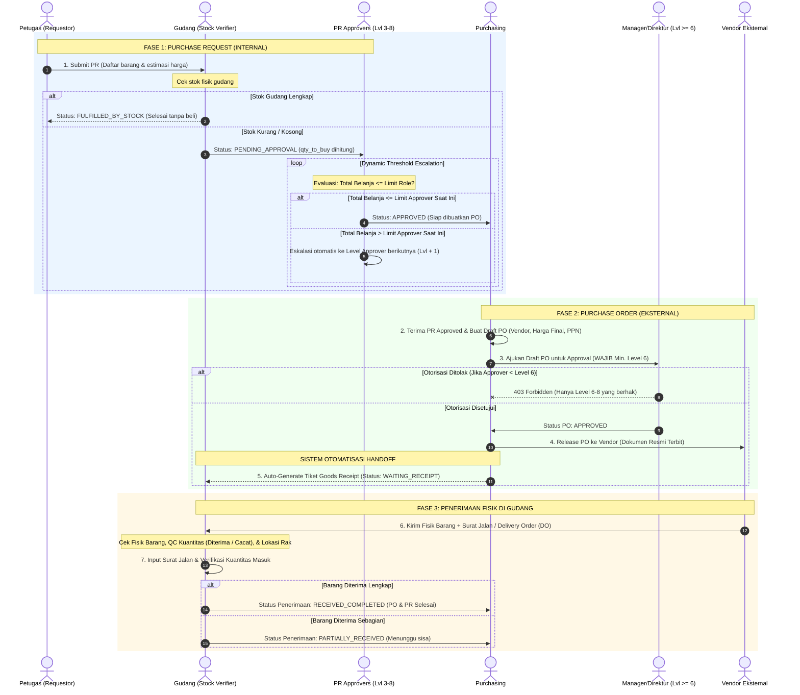
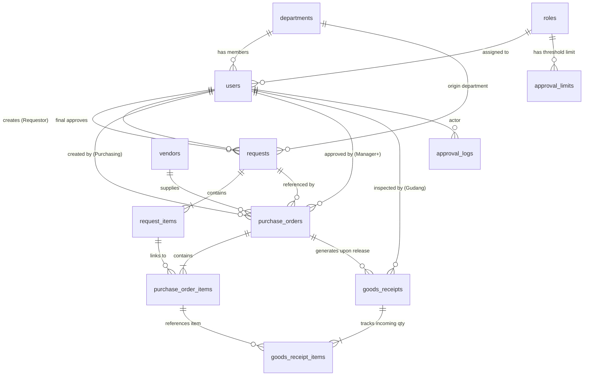

# Arsitektur Sistem Permohonan Barang (Goods Request System)
**Berbasis Role-Based Access Control (RBAC) & Dynamic Threshold Routing**

---

## 1. Hierarki Peran Pengguna (User Roles & Hierarchy)

| Level | Kode Role | Nama Peran | Tugas & Batasan Otoritas |
|:---:|:---|:---|:---|
| **0** | `SYST000` | Admin Sistem / Superadmin | Akses eksklusif master user, limit approval PR (Level 3-8), dan PO rule. Tidak ikut approval transaksi. |
| **1** | `REQUESTOR` | Petugas (Requestor) | Pembuat draf dan pengaju form permohonan barang (PR). |
| **2** | `GUDANG` | Gudang (Inventory Verifier) | Pengecek fisik ketersediaan stok awal gudang dan penentu `qty_to_buy`. |
| **3** | `SUPERVISOR` | Supervisor | PR Approver Level 1 (Batas nominal Rp 0 s/d limit L1). |
| **4** | `KEPALA_BAGIAN` | Kepala Bagian | PR Approver Level 2 (Batas nominal s/d limit L2). |
| **5** | `ASISTEN_MANAGER` | Asisten Manager | PR Approver Level 3 (Batas nominal s/d limit L3). |
| **6** | `MANAGER` | Manager | PR Approver Level 4 **& Minimal PO Approver Level**. |
| **7** | `DIREKTUR` | Direktur | PR Approver Level 5 & PO Approver. |
| **8** | `DIREKTUR_UTAMA` | Direktur Utama | PR Approver Level 6 (Highest Threshold) & PO Approver. |
| **9** | `PURCHASING` | Purchasing | Pembuat draft Purchase Order (PO) dari PR yang sudah `APPROVED`, penunjuk vendor, dan penerbit PO ke vendor setelah di-approve Manager. |

---

## 2. Alur Dua Fase Siklus (Two-Phase Approval Workflow)

---

## 3. Skema Relasi Database (ERD)

---

## 4. Mekanisme Dynamic Threshold Routing (PR Phase)

1. Tabel `approval_limits` menyimpan rentang `[min_amount, max_amount]` untuk role level 3 sampai 8.
2. Ketika Gudang selesai verifikasi dan menetapkan `qty_to_buy`, sistem menghitung:
   $$\text{Total Belanja PR} = \sum (\text{qty\_to\_buy} \times \text{estimated\_unit\_price})$$
3. PR selalu dimulai dari approver terendah (Level 3 - Supervisor).
4. Pada saat approver Level $k$ menekan tombol **Approve**:
   - Jika $\text{Total Belanja PR} \le \text{Max Amount}_{\text{Level } k}$ atau $k = 8$: PR disetujui secara final (`status = 'APPROVED'`).
   - Jika $\text{Total Belanja PR} > \text{Max Amount}_{\text{Level } k}$: Dokumen dinaikkan secara otomatis ke level berikutnya ($k + 1$) tanpa perlu membuat dokumen baru.

---

## 5. Validasi Aturan PO Approval (PO Phase)

1. Hanya user dengan `role_code = 'PURCHASING'` (Role Level 9) yang diizinkan mengakses menu pembuatan Draft PO.
2. Draft PO hanya bisa dibentuk dari PR yang statusnya sudah `APPROVED`.
3. Sebelum PO berstatus `RELEASED_TO_VENDOR`, draft PO harus melalui persetujuan manajemen.
4. **Hard Security Rule**:
   $$\text{Approver Role Level} \ge 6 \quad (\text{Manager, Direktur, atau Direktur Utama})$$
   Upaya persetujuan oleh user dengan level $< 6$ (Supervisor, Asisten Manager, Gudang, atau Petugas) akan secara otomatis diblokir oleh middleware backend (`requireMinRoleLevel(6)`).

---

## 6. Otomatisasi Tiket Penerimaan Barang ke User Gudang (Goods Receiving)

Ketika user Purchasing mengeksekusi aksi **Release PO to Vendor**:
1. Status PO berubah menjadi `RELEASED_TO_VENDOR`.
2. **Trigger Otomatis**: Sistem secara otomatis meng-generate tiket penerimaan barang (`goods_receipts`) dengan nomor acuan baru (misal: `GR-202610-001`) dan status awal **`WAITING_RECEIPT`**.
3. Seluruh rincian item PO disalin ke `goods_receipt_items` dengan `qty_ordered = po_item.qty` dan nilai awal `qty_received = 0`.
4. Tiket ini langsung muncul di dashboard menu **"Penerimaan Barang Masuk"** milik user **Gudang (Level 2)**.
5. Saat kurir/vendor tiba membawa fisik barang beserta Surat Jalan (Delivery Order):
   - Petugas Gudang membuka tiket `goods_receipts` terkait.
   - Menginput nomor Surat Jalan vendor (`vendor_delivery_note_number`).
   - Memasukkan kuantitas riil yang diterima (`qty_received`), kuantitas lolos QC (`qty_accepted`), dan kuantitas rusak/retur (`qty_rejected`).
   - Menetapkan nomor rak penyimpanan (`warehouse_bin_location`).
   - Jika kuantitas sudah lengkap, status berubah menjadi `RECEIVED_COMPLETED` dan siklus PR-PO ditutup (`COMPLETED`).

