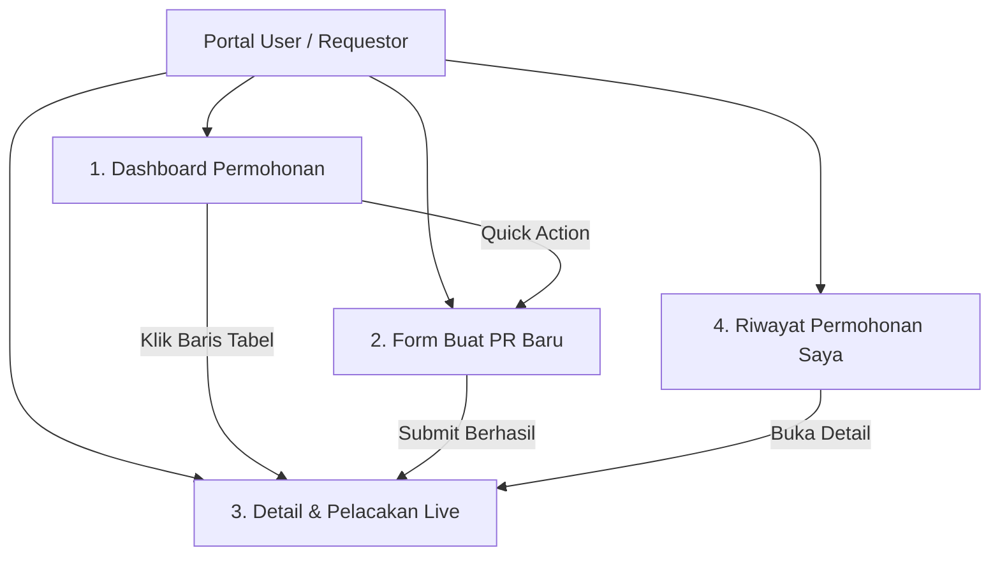

# Spesifikasi Desain UI/UX - Portal User (Petugas / Requestor)
**Sistem Permohonan Barang (Goods Request System)**

---

## 1. Ringkasan & Persona Pengguna (User Persona)

* **Role**: Petugas / Pegawai Pengaju (`role_code: REQUESTOR`, Level 1).
* **Tujuan Pengguna**:
  1. Mengajukan kebutuhan pengadaan barang atau perlengkapan kantor secara mudah dan cepat.
  2. Mengetahui estimasi jalur persetujuan sebelum mengirimkan permohonan.
  3. Memantau posisi dokumen secara *real-time* (apakah sedang dicek Gudang, menunggu approval Manager, atau sudah diproses Purchasing).
  4. Melihat kejelasan status barang: apakah dipenuhi dari sisa stok gudang atau dibeli via PO baru.

---

## 2. Design System & Style Guide

### A. Palet Warna (Color Palette)
| Token | HEX / Nilai | Penggunaan |
|:---|:---|:---|
| **Primary (Brand)** | `#2563eb` (Blue-600) | Tombol aksi utama, tautan aktif, stepper aktif, nomor PR. |
| **Primary Hover** | `#1d4ed8` (Blue-700) | Efek hover tombol utama. |
| **Success** | `#059669` (Emerald-600) | Status `RECEIVED_COMPLETED`, barang disetujui, centang stepper selesai. |
| **Warning / Attention**| `#d97706` (Amber-600) | Status `IN_STOCK_CHECK` (Gudang), kuantitas stok rak, peringatan. |
| **Pending / Escalation**| `#4f46e5` (Indigo-600) | Status `PENDING_APPROVAL` pimpinan bertingkat. |
| **PO Issued** | `#7c3aed` (Purple-600) | Status fase `PO_CREATED` & `RELEASED_TO_VENDOR`. |
| **Danger / Rejected** | `#dc2626` (Red-600) | Status `REJECTED`, tombol hapus baris, badge kesalahan. |
| **Surface & Background**| `#f8fafc` & `#ffffff` | Background kanvas bersih dengan kontras tinggi. |
| **Borders** | `#e2e8f0` (Slate-200) | Garis pemisah tabel, kartu, dan input form. |

### B. Tipografi & Skala Teks
* **Font Family**: Inter, Roboto, atau font Sans-Serif modern sistem operasi.
* **Header H1/Title**: `18px - 20px`, Bold (`font-bold`, `tracking-tight`).
* **Sub-Header / Card Title**: `14px - 16px`, Semi-bold (`font-semibold`).
* **Body Text**: `12px - 14px`, Regular (`text-xs` hingga `text-sm`).
* **Data Monospace**: `12px`, Monospace (`font-mono`) untuk Nomor PR (`PR-202610-xxx`), Nomor PO, dan angka mata uang Rupiah.

---

## 3. Arsitektur Antarmuka (4 Layar Utama)

---

## 4. Rincian Fitur Setiap Halaman

### 1. Dashboard Permohonan (Home View)
* **Hero Banner**: Menyapa nama pengguna, peran, dan tombol CTA langsung `"Mulai Buat PR Baru"`.
* **4 Metrik KPI Utama**:
  1. *Total Permohonan*: Jumlah semua PR yang pernah diajukan.
  2. *Dalam Verifikasi Gudang*: PR yang sedang diperiksa ketersediaan stok fisiknya oleh petugas gudang.
  3. *Menunggu Otorisasi*: PR yang sedang dievaluasi oleh Supervisor / Kabag / Manager.
  4. *Selesai / Diterima*: PR yang barang fisiknya telah diterima lengkap.
* **Tabel Permohonan Aktif**: Menampilkan daftar PR terkini dengan status badge warna-warni dan tombol cepat `"Lacak Detail"`.

---

### 2. Formulir Pengajuan Permohonan Barang (Create PR)
* **Seksi 1: Informasi Header Dokumen**
  - Nomor PR: Otomatis dibangkitkan sistem (`PR-YYYYMM-XXX`).
  - Pemohon & Departemen: Terisi otomatis sesuai data login pengguna.
  - Tanggal Dibutuhkan: Datepicker tanggal target kedatangan barang.
  - Alasan / Keperluan: Textarea untuk penjelasan urgensi pengadaan.
* **Seksi 2: Repeater Tabel Barang Dinamis**
  - Kolom: `#`, `Nama Barang`, `Spesifikasi/Merk`, `Qty`, `Satuan`, `Estimasi Harga Satuan (Rp)`, `Subtotal (Rp)`, `Aksi Hapus`.
  - Fitur Auto-Calculate: Setiap perubahan Qty atau Harga Satuan langsung memperbarui Subtotal baris dan Grand Total PR secara *instant*.
  - Tombol `+ Tambah Baris Barang` untuk menambah item tanpa batas.
* **Seksi 3: Indikator Prediksi Dynamic Routing Escalation**
  - Kotak cerdas yang langsung memprediksi batas approval sesuai total belanja:
    - $\le \text{Rp } 10.000.000$: Cukup disetujui Level 3 (Supervisor).
    - $\le \text{Rp } 50.000.000$: Eskalasi ke Level 4/6 (Manager).
    - $> \text{Rp } 50.000.000$: Memerlukan otorisasi Level 7/8 (Direktur / Dirut).
* **Seksi 4: Lampiran Dokumen Pendukung**
  - Drag-and-drop file upload untuk penawaran harga vendor sementara atau lembar disposisi (PDF/JPG maks 5MB).
* **Aksi Formulir**:
  - `Batal`, `Simpan Draf`, `Submit PR`.

---

### 3. Detail & Pelacakan Live (Live Stepper & Transparency View)
* **5-Tahapan Horizontal Stepper**:
  1. *Pengajuan PR* (Pemohon)
  2. *Cek Stok Gudang* (Petugas Gudang memverifikasi stok rak)
  3. *Otorisasi Bertingkat* (Supervisor $\rightarrow$ Manager)
  4. *Penerbitan PO* (Purchasing memproses vendor)
  5. *Penerimaan Fisik* (Barang tiba di gudang & diserahterimakan)
* **Tabel Komparasi Stok vs Belanja**:
  - Menampilkan transparansi pemenuhan:
    - `Qty Permintaan`: Jumlah yang diajukan user.
    - `Stok Rak Gudang`: Berapa unit yang langsung diambil dari gudang.
    - `Qty to Buy`: Berapa unit yang harus dibeli melalui Purchasing (PO).
* **Catatan Petugas Gudang**: Kotak khusus berisi penjelasan jika stok gudang habis atau disubstitusi.
* **Audit Trail Log**: Riwayat kronologis lengkap dengan waktu, nama petugas yang mengeksekusi, dan catatan status.

---

### 4. Riwayat Permohonan Saya (Archive & Search Table)
* Fitur pencarian instan berdasarkan No PR atau nama barang.
* Filter status: *Semua*, *Sedang Berjalan*, *Selesai Diterima*, *Ditolak*.
* Tautan langsung ke nomor PO jika PR tersebut telah terbit PO dari bagian Purchasing.
* Tombol cetak / export untuk kebutuhan tanda tangan basah atau arsip fisik kantor.

---

## 5. Berkas Prototipe Interaktif yang Telah Dibuat
File prototipe siap pakai telah disimpan pada:
* **[user-ui-prototype.html](file:///d:/GAR/Flowrequest%20barang/docs/user-ui-prototype.html)** (Dapat langsung dibuka di Google Chrome / Edge / Firefox tanpa perlu build step apa pun).
